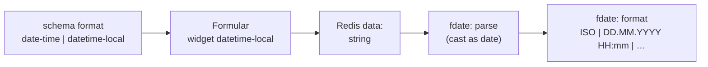

# Schema — string: format formular vs fdate (alg)

Câmpurile **`type: "string"`** din `schema:_…` pot avea **`format`** pentru widget-ul JSONEditor (tab **Formular** pe `data:` / Live). Asta e **stocarea și editarea**, nu textul afișat în listă sau mesaje.

## Formate în editorul vizual de schemă

În **schema:_…** → tab **Formular**, la câmp **string**, **Afișare string**:

| Alegere UI | `format` în JSON Schema | Widget JSONEditor (typic) |
|------------|-------------------------|---------------------------|
| câmp scurt (input) | *(lipsă)* | `<input type="text">` |
| text multiline (textarea) | `textarea` | `<textarea>` |
| dată (date) | `date` | `<input type="date">` → valoare tip **`YYYY-MM-DD`** |
| oră (time) | `time` | `<input type="time">` |
| dată și oră ISO (date-time) | `date-time` | La **Formular**, JSONEditor primește alias `datetime-local` (vendor); în Redis schema rămâne `date-time` |
| dată și oră locală (datetime-local) | `datetime-local` | același widget ca mai sus; intenție documentată: valoare **fără zonă** |

Opțional: **Înălțime textarea** → `options.input_height` (ex. `280px`).

Tab **JSON** pe schemă acceptă aceleași valori `format` manual.

### `date-time` vs `datetime-local` — ce contează de fapt

| Aspect | `date-time` în schemă | `datetime-local` în schemă |
|--------|----------------------|----------------------------|
| Widget Formular / Live | **Identic** (`datetime-local`, alias vendor) | **Identic** |
| Câmp `format` salvat în `schema:_…` | rămâne `date-time` | rămâne `datetime-local` |
| Valoare tipică după picker | `"2026-09-30T15:30"` (fără `Z`/offset) | la fel |
| Semnificație recomandată | poți **pretinde** ISO cu zonă dacă editezi JSON / alg la save | „wall clock” local, fără zonă în string |
| **`fdate` citește `format` din schemă?** | **Nu** | **Nu** |

**Important:** diferența dintre cele două opțiuni în meta-editor este **intenție și documentație**, nu un pipeline diferit în motor. **`fdate`** lucrează doar cu **stringul stocat** în `data:` / `form.*` și cu **`format` din pasul alg** (tokenii `ISO`, `DD`, …).

## Stocare (Redis / `form.*`) vs afișare (`fdate`)

| Strat | Unde | Rol |
|-------|------|-----|
| **JSON Schema `format`** | `schema:_…` | Cum editezi și ce **convenție de string** salvezi |
| **`fdate` → `format`** | `alg:_…` | Cum **formatezi** o dată deja citită pentru UI / log / listă |

Tokenii **`fdate`** (`DD.MM.YYYY`, `HH:mm`, `ISO`, `HHU`, …) **nu** se pun în `format` din schemă. Vezi **Operații alg** → **fdate**.

### Mapare practică (storage ↔ fdate)

| Nevoie | `format` în schemă | Exemplu valoare stocată | Exemplu `fdate` în alg (afișare) |
|--------|-------------------|-------------------------|----------------------------------|
| Doar zi | `date` | `"2026-09-30"` | `{ "op": "fdate", "from": "form.created_at", "format": "DD.MM.YYYY", "to": "lbl" }` |
| Zi + oră (formular) | `date-time` **sau** `datetime-local` | `"2026-09-30T15:30"` (typic picker) | `{ "op": "fdate", "format": "DD.MM.YYYY HH:mm", "from": "form.created", "to": "lbl" }` |
| Zi + oră (ISO în Redis) | orice | `"2026-09-30T12:30:00.000Z"` | afișare locală: `DD.MM.YYYY HH:mm`; UTC: `ISO` sau `DDU.MM.YYYY HHU:mm` |
| Doar oră | `time` | `"15:30"` / `"15:30:00"` | `{ "op": "fdate", "format": "HH:mm", ... }` (dacă parsarea reușește) |
| Audit / API | *(nu depinde de eticheta schemă)* | ISO cu `Z` sau offset | `{ "op": "fdate", "format": "ISO", "from": "form.created", "to": "audit_ts" }` |

**Intrare `fdate`:** valoarea din `form.camp` (sau `val`) trece prin **`cast` as `date`** (`parseRelativeDate` — ISO, timestamp ms, `now +2day`, etc.). Dacă stringul nu e parsabil → `''`.

### Parsare intrare (`cast as date` / `parseRelativeDate`)

Motorul **nu** consultă `format` din JSON Schema. Contează **forma stringului** (sau numărul ms):

| Formă stocată | Exemplu | La parse (JavaScript `Date`) |
|---------------|---------|------------------------------|
| ISO cu UTC | `"2026-09-30T12:30:00.000Z"` | instantă UTC fixă |
| ISO cu offset | `"2026-09-30T15:30:00+03:00"` | instantă corectă pe offset |
| Dată+oră **fără zonă** (picker / `datetime-local`) | `"2026-09-30T15:30"` | interpretată ca **oră locală** (wall clock în fusul serverului/browser la parse) |
| Doar dată | `"2026-09-30"` | dată locală (midnight local) |
| Timestamp ms | `1790769600000` | instantă absolută |

După parse există un singur obiect `Date` intern; **ieșirea** depinde doar de tokenii din `format` la **`fdate`**.

### Modalități de conversie recomandate (`fdate` → `format`)

Alege **`format` în alg** după **ce vrei să arăți**, nu după eticheta `date-time` / `datetime-local` din schemă:

| Scop | `format` fdate recomandat | Când |
|------|---------------------------|------|
| **Ca în formular** (aceeași oră pe ecran, fără salt UTC) | `DD.MM.YYYY HH:mm` sau `YYYY-MM-DD HH:mm` | Valoare tipică din picker: `…T15:30` fără `Z` |
| **Export / log ISO (UTC)** | `ISO` | Orice valoare parsabilă → `toISOString()` (componente UTC, terminat cu `Z`) |
| **Raport cu componente UTC** | `DDU.MM.YYYY HHU:mm` (sau mix tokeni `…U`) | Vrei cifre din calendar UTC, nu locale |
| **Raport local explicit** | `YYYY-MM-DDTHH:mm:ss` (tokeni fără `U`) | Listă tehnică în fus local |
| **Doar zi** (câmp `date`) | `DD.MM.YYYY` | Stocare `YYYY-MM-DD` |

**Efecte de fus (exemplu):** stocat `"2026-09-30T15:30"` (local), server UTC+3 → `fdate` cu `ISO` poate afișa `"2026-09-30T12:30:00.000Z"`. Asta nu e bug: **ISO = UTC**. Pentru etichete user, preferă tokeni **locali** (`HH`, `DD`), nu `ISO`.

**ISO garantat în Redis:** formularul nu scrie singur `Z`. Opțiuni: editare tab JSON pe `data:`, pas alg la save (`fdate` + `ISO` în alt câmp, sau normalizare custom), import API.

### Eroare JSONEditor „Datetime must be in the format YYYY-MM-DD HH:MM”

JSONEditor validează `datetime-local` cu un regex strict; **`""` (string gol)** de la câmp nou / `valoareImplicitaDinSchema` **nu trece** validarea și afișează mesajul roșu chiar dacă câmpul e opțional.

La încărcarea formularului, **sside** normalizează `startval`: elimină cheile dată/oră goale și convertește valori ISO parsabile în **`YYYY-MM-DD HH:MM`** (convenția internă JSONEditor / flatpickr). După refresh, câmpul gol nu mai ar trebui să declanșeze eroarea până nu introduci o valoare invalidă.

### Rețete alg (copy-paste)

Afișare listă — valoare din formular (picker):

```json
{ "op": "fdate", "from": "form.created", "format": "DD.MM.YYYY HH:mm", "to": "lbl_created" }
```

Log audit — aceeași sursă, ieșire UTC:

```json
{ "op": "fdate", "from": "form.created", "format": "ISO", "to": "audit_created" }
```

Valoare deja ISO în Redis, afișare locală user:

```json
{ "op": "fdate", "from": "form.created", "format": "DD.MM.YYYY HH:mm", "to": "lbl_created" }
```

### Flux mental (schemă → stocare → fdate)



`S` **nu** leagă direct la `O`; doar `R` + tokenii `format` din pasul `fdate`.

## Referințe

- Form / Live layout: [form-ui.md](form-ui.md)
- Tokeni și timp relativ: [alg-ops.md](alg-ops.md) → **fdate**
